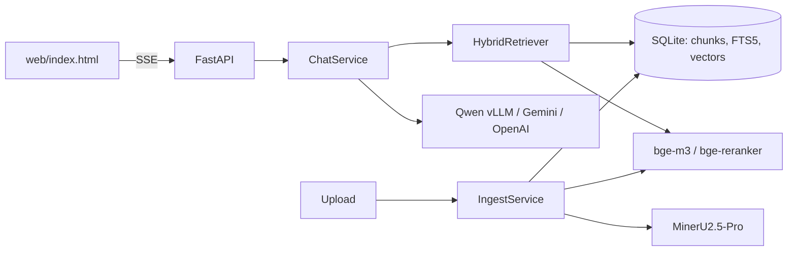
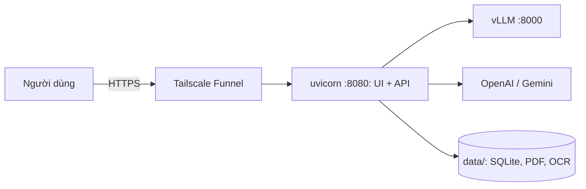

# Banking Docs RAG

Chatbot tra cứu văn bản nghiệp vụ ngân hàng bằng tiếng Việt. Trả lời chỉ dựa trên tài liệu đã nạp, kèm trích dẫn `[S1]` mở được đúng trang PDF gốc. Thiếu dữ kiện thì hỏi lại, thiếu căn cứ thì nói rõ.

Bản triển khai này chạy **local** (FastAPI + SQLite). Thiết kế gốc cho Cloudflare nằm ở [`docs/`](docs/).

## Mục lục

- [Tính năng](#tính-năng)
- [Kiến trúc](#kiến-trúc)
- [Cấu trúc thư mục](#cấu-trúc-thư-mục)
- [Yêu cầu](#yêu-cầu)
- [Cài đặt](#cài-đặt)
- [Cấu hình](#cấu-hình)
- [Chạy](#chạy)
- [API](#api)
- [Đánh giá chất lượng](#đánh-giá-chất-lượng)
- [Bảo mật](#bảo-mật)
- [Triển khai](#triển-khai)
- [Giới hạn đã biết](#giới-hạn-đã-biết)
- [Xử lý sự cố](#xử-lý-sự-cố)

## Tính năng

- Nạp PDF (kể cả bản scan), DOCX, TXT, PNG, JPG; tài liệu mới dùng được ngay, không cần khởi động lại.
- Tìm kiếm lai: FTS5 (từ khóa, không dấu) + vector `bge-m3` → RRF → rerank `bge-reranker-v2-m3`.
- Chat qua SSE. Mỗi câu trả lời có một chế độ: `answer`, `clarify` (hỏi lại), `insufficient` (chưa đủ căn cứ), `offscope` (ngoài phạm vi), `chitchat` (câu cố định). Server giữ câu trả lời đến khi qua kiểm tra rồi gửi một lần; giao diện hiện dần từng cụm chữ.
- Ba phong cách trả lời trong Cài đặt: Tự nhiên & thân thiện (mặc định, xưng "em", gọi "anh/chị"), Ngắn gọn, Chi tiết. Câu nhiều ý trình bày bằng gạch đầu dòng, mỗi ý kèm nguồn.
- Câu hỏi không phải tra cứu nghiệp vụ (trừ chào hỏi, giới thiệu) nhận câu cố định "Em chưa được thiết lập để trả lời câu hỏi này".
- Mỗi câu trả lời hiện số token vào/ra khi model báo.
- Tốc độ: ma trận embedding cache trong bộ nhớ, embedder và reranker nạp sẵn khi khởi động.
- **Văn bản sửa đổi/thay thế:** khi câu hỏi liên quan một nhóm văn bản sửa đổi nhau (ví dụ 66 → 549 → 955 → 1866), hệ thống kéo thêm đoạn của các phiên bản bị bỏ sót, gắn nhãn `MỚI NHẤT`/`CŨ HƠN` cho model, yêu cầu kết luận theo bản mới nhất rồi nêu "Trước đây, …" để so sánh, và luôn hiện khung "Có nhiều phiên bản liên quan" (mới nhất trước, bấm mở từng bản) do server dựng, không phụ thuộc model.
- Trích dẫn kiểm tra phía server: mã `[Sx]` không có trong danh sách nguồn không thành liên kết; bấm mở đoạn trích và PDF đúng trang.
- Chốt chính xác: câu trả lời được giữ lại đến khi qua kiểm tra (trích dẫn hợp lệ, mọi số có trong nguồn, không còn chữ mẫu `<...>`). Không qua thì sinh lại một lần; vẫn không qua thì hệ thống nêu lý do và hỏi lại một câu cụ thể thay vì đưa câu trả lời chưa kiểm chứng.
- Câu chào hỏi, cảm ơn, hỏi về trợ lý được trả lời cố định, không tra cứu. Có thể bật thêm model phân loại ý định (`INTENT_*`) để chặn câu ngoài phạm vi và câu quá chung chung.
- Thêm endpoint chat riêng (vLLM/OpenAI-compatible) ngay trong Cài đặt khi `ALLOW_CUSTOM_ENDPOINTS=1`.
- Nhiều nhà cung cấp chat qua một adapter OpenAI-compatible: Qwen (vLLM local), Gemini, OpenAI. Nhà cung cấp chưa có key tự ẩn khỏi giao diện; server kiểm tra allowlist.
- OCR chọn được: MinerU (local, mặc định) hoặc Gemini (`OCR_BACKEND=gemini`).
- Thương hiệu (tên tổ chức, logo, thông tin tác giả) đọc từ `.env`, repo không chứa danh tính; để trống thì hiện chỗ đặt logo trung tính.
- Giao diện tối giản, sáng/tối, responsive, robot nón lá phản ứng theo trạng thái chat.

## Kiến trúc



Luồng nạp: `extract (OCR) → chunk (theo điều/khoản, giữ nguyên bảng) → embed → ghi SQLite` (xóa và ghi lại trong một transaction nên chạy lại không nhân bản).
Luồng hỏi: `câu hỏi → (viết lại nếu có lịch sử) → FTS top-20 + vector top-20 → RRF → rerank top-30 → 6 đoạn → LLM → kiểm tra số/trích dẫn`.

## Cấu trúc thư mục

```text
app/
├── main.py            # create_app: middleware, router, static
├── container.py       # composition root (dựng và nối các service)
├── config.py          # đọc .env, đường dẫn, provider, branding, giới hạn
├── api/               # routers mỏng (meta, session, documents, chat) + auth, security, sse
├── chat_service.py    # điều phối hỏi đáp, tách thẻ chế độ, kiểm tra
├── retrieval.py       # HybridRetriever, RRF
├── versions.py        # phát hiện văn bản sửa đổi và nhóm phiên bản (theo tiêu đề)
├── version_service.py # kéo thêm phiên bản liên quan, nhãn MỚI NHẤT/CŨ HƠN
├── ingest.py          # IngestService
├── extract.py         # extractor theo định dạng + OcrRunner (cache từng trang)
├── ocr.py             # OcrEngine: MinerUEngine, GeminiEngine
├── chunking.py        # chia đoạn theo điều/khoản, giữ bảng
├── store.py           # SQLite (documents, chunks, FTS, vector)
├── embedding.py       # Embedder, Reranker (tải lười)
├── llm.py             # OpenAICompatProvider, ChatError
├── prompt.py          # system prompt và dựng messages
├── answer_guard.py    # thẻ chế độ, kiểm tra số/trích dẫn, bỏ chữ mẫu
├── intent.py          # luật + model phân loại ý định
├── smalltalk.py       # câu trả lời cố định cho chào hỏi
├── providers.py       # provider tích hợp + endpoint thêm từ Cài đặt
├── metadata.py        # số hiệu/ngày ban hành
└── textnorm.py        # bỏ dấu, escape truy vấn FTS
web/                   # index.html, style.css, app.js, api.js, robot.js, util.js, config.js (không inline script/style)
deploy/                # install.sh (systemd), expose.sh (Funnel/cloudflared), rag-api.service.in
.github/workflows/     # pages.yml (UI → GitHub Pages), backend.yml (self-hosted runner)
scripts/               # run_vllm.sh, build_static.py, ocr_mineru.py, render_pages.py
tests/                 # pytest: guard, text, API/bảo mật, Gemini OCR (mock)
eval/                  # questions.json, run_retrieval.py, run_chat.py
private/brand/         # logo thật (gitignored), trỏ tới bằng .env
data/                  # PDF nguồn, cache OCR, SQLite (gitignored)
docs/                  # thiết kế gốc (Cloudflare)
```

Phụ thuộc đi một chiều: `api → services → (retrieval, store, embedding, llm)`; service nhận phụ thuộc qua constructor, chỉ `container.py` biết lớp cụ thể. Thêm provider hoặc định dạng file không cần sửa code hiện có (`config.PROVIDERS`, `extract.extractor_for`).

## Yêu cầu

- Linux, Python 3.10, [uv](https://docs.astral.sh/uv/), Docker (cho vLLM).
- GPU NVIDIA ≥ 8 GB, driver ≥ 570. Đã kiểm tra: RTX 4060 Laptop 8 GB.
- Bộ nhớ GPU chia sẻ: vLLM ≈ 3.7 GB + embedding/reranker ≈ 2.5 GB. OCR (≈ 2.8 GB) chạy riêng, không đồng thời với cả hai.

## Cài đặt

Máy Mac (M2 8 GB, chat qua OpenAI): xem [docs/SETUP-MAC.md](docs/SETUP-MAC.md).

```bash
# môi trường ứng dụng
uv venv --python 3.10 .venv
uv pip install --python .venv/bin/python -r requirements.txt \
  --index-url https://download.pytorch.org/whl/cu128 --extra-index-url https://pypi.org/simple

# môi trường OCR (MinerU2.5-Pro)
uv venv --python 3.10 .venv-mineru
uv pip install --python .venv-mineru/bin/python "mineru[core]" transformers accelerate
uv pip install --python .venv-mineru/bin/python --reinstall torch torchvision \
  --index-url https://download.pytorch.org/whl/cu128

cp .env.example .env            # điền key, logo, mật khẩu
uv pip install --python .venv/bin/python -r requirements-dev.txt   # chỉ để chạy pytest
```

Model Hugging Face (bge-m3, bge-reranker, MinerU) tự tải ở lần chạy đầu.

## Cấu hình

Sao chép `.env.example` thành `.env` (đã nằm trong `.gitignore`, cùng `private/`, `data/` và `docs/bo-logo-*`; không commit). Giá trị để trống, `***REMOVED***` hoặc bắt đầu bằng `your-` được coi là chưa đặt.

| Biến | Mặc định | Ý nghĩa |
|---|---|---|
| `ORG_NAME`, `AUTHOR_INFO` | – | Tên tổ chức (tiêu đề, prompt) và dòng tác giả ở footer |
| `BRAND_LOGO_HEADER`, `BRAND_LOGO_FOOTER_LIGHT`, `BRAND_LOGO_FOOTER_DARK` | – | Đường dẫn logo png/webp/jpg (không nhận SVG) |
| `CHAT_PROVIDER` | `openai` | Provider mặc định: `qwen`, `gemini`, `openai` |
| `QWEN_BASE_URL` | trống | Endpoint vLLM, ví dụ `http://127.0.0.1:8000/v1`. Trống thì ẩn lựa chọn Qwen |
| `OPENAI_API_KEY`, `OPENAI_CHAT_MODEL` | –, `gpt-4.1-mini` | OpenAI; model là danh sách phân tách bằng dấu phẩy, mục đầu là mặc định. Eval 14 câu: `gpt-4.1-mini` 13/14, `gpt-5.4-mini` 13/14, `gpt-5.4-nano` 12/14 |
| `GEMINI_API_KEY`, `GEMINI_CHAT_MODEL` | –, `gemini-3.5-flash` | Gemini chat (endpoint OpenAI-compatible) |
| `OCR_BACKEND`, `GEMINI_OCR_MODEL` | `mineru`, `gemini-3.5-flash` | OCR; `gemini` gửi ảnh trang lên Google |
| `APP_PASSWORD`, `APP_USER` | –, `admin` | Bật đăng nhập khi đặt `APP_PASSWORD` (curl/eval dùng được Basic với `APP_USER`) |
| `APP_SECRET` | suy ra từ mật khẩu | Khóa ký token phiên và link tài liệu |
| `ALLOWED_ORIGINS` | – | Origin của giao diện host riêng (Pages), cách nhau bằng dấu phẩy; trống = chỉ cùng origin |
| `TRUST_PROXY` | `0` | `1` sau Cloudflare/nginx để giới hạn tốc độ theo IP thật |
| `LLM_TIMEOUT` | `15` | Giây chờ model không trả byte nào thì báo lỗi "Model phản hồi quá lâu". Model lớn hoặc ở xa có thể cần tăng |
| `ALLOW_CUSTOM_ENDPOINTS` | `0` | `1` cho phép thêm/xóa endpoint chat trong Cài đặt (lưu ở `data/endpoints.json`, mode 600). Server sẽ gọi URL được nhập, nên chỉ bật trong mạng tin cậy và nên đặt `APP_PASSWORD`. Chặn địa chỉ link-local/metadata; không theo redirect khi dò model |
| `INTENT_BASE_URL`, `INTENT_MODEL`, `INTENT_API_KEY` | trống | Model nhỏ (OpenAI-compatible) gán nhãn `chitchat`/`out_of_scope`/`vague`/`domain` trước khi tìm kiếm. Trống thì chỉ dùng luật cố định. Lỗi model thì coi như `domain` |
| `RAG_DEVICE` | `cuda` | `cpu` để chạy embedding/rerank không GPU |
| `EMBED_MODEL`, `RERANK_MODEL` | `BAAI/bge-m3`, `BAAI/bge-reranker-v2-m3` | Đổi embedding thì phải nạp lại |

Tham số tìm kiếm (top-k) ở `config.RETRIEVAL`. Client chỉ chọn provider/model trong allowlist (kể cả endpoint đã thêm); key không bao giờ trả về client; `/api/config` chỉ trả tên, giới hạn và thương hiệu.

## Chạy

```bash
scripts/run_vllm.sh                                   # Qwen3.5-2B tại :8000
.venv/bin/python scripts/render_pages.py              # PDF → PNG từng trang
.venv-mineru/bin/python scripts/ocr_mineru.py data/ocr data/pages/*.png
.venv/bin/python -m app.ingest data/raw               # chunk, embed, ghi SQLite
.venv/bin/uvicorn app.main:app --port 8080            # mở http://localhost:8080
```

Bước OCR chỉ cần một lần (cache ở `data/ocr/`, MinerU khoảng 30 giây mỗi trang). Tài liệu upload qua giao diện tự OCR bằng engine trong `OCR_BACKEND`.

## API

| Method | Đường dẫn | Mô tả |
|---|---|---|
| GET | `/api/health` | Kiểm tra sống (luôn mở, không cần auth) |
| GET | `/api/branding` | Công khai: cần đăng nhập không, tên, logo |
| POST | `/api/login` | `{password}` → token phiên (12 giờ) |
| GET | `/api/config` | Provider khả dụng và giới hạn (không lộ key/endpoint/đường dẫn) |
| GET | `/api/brand/{slot}` | Logo cấu hình trong `.env` (`header`, `footer-light`, `footer-dark`) |
| GET | `/api/documents` | Danh sách tài liệu và trạng thái |
| POST | `/api/documents` | Upload (multipart `file`), trả `202`, nạp nền |
| GET | `/api/documents/{id}/link` | URL ký sẵn, sống 10 phút, chỉ cho đúng tài liệu đó |
| GET | `/api/documents/{id}/file` | File gốc, hỗ trợ range (cần token phiên hoặc link ký) |
| POST | `/api/chat` | Hỏi đáp, trả SSE |
| POST / DELETE | `/api/endpoints`, `/api/endpoints/{key}` | Thêm/xóa endpoint chat (cần `ALLOW_CUSTOM_ENDPOINTS=1`) |

Mọi route `/api` trừ `health`, `branding`, `login`, `brand/*` cần `Authorization: Bearer <token>` (hoặc Basic cho script). Sự kiện SSE theo thứ tự: `status`* → `sources`? → `mode` → `delta` → `done`, hoặc `error`. Câu trả lời được gửi một lần sau khi qua kiểm tra, không stream từng token.

```bash
curl -N -H 'content-type: application/json' \
  -d '{"messages":[{"role":"user","content":"Văn bản 549 ban hành ngày nào?"}],"provider":"qwen"}' \
  http://localhost:8080/api/chat
```

## Đánh giá chất lượng

```bash
.venv/bin/python -m pytest -q                 # đơn vị, API/bảo mật, Gemini OCR (mock)
.venv/bin/python eval/run_retrieval.py        # tài liệu đúng nằm trong top-6, có chứa dữ kiện
.venv/bin/python eval/run_chat.py qwen        # đầu-cuối qua API (đặt APP_USER/APP_PASSWORD nếu bật auth)
```

Kết quả hiện tại (14 câu hỏi tự viết, Qwen3.5-2B):

| Phép đo | Kết quả |
|---|---|
| Retrieval (tài liệu và dữ kiện nằm trong top-6) | 13/13 |
| Chat đầu-cuối | 11 đến 13/14, dao động giữa các lần chạy |

Bộ câu hỏi nhỏ và prompt đã chỉnh theo nó, nên điểm có thể cao hơn thực tế. Cần thêm câu hỏi do nghiệp vụ viết trước khi tin vào con số.

**OCR (so sánh trên trang mẫu):** MinerU2.5-Pro đọc đúng dấu tiếng Việt và giữ được bảng; PaddleOCR (PP-OCRv5, `vi`) mất nhiều dấu và chậm trên CPU nên bị loại; VietOCR chỉ nhận dạng, cần thêm bộ phát hiện chữ nên chưa thử. Gemini OCR chưa so sánh được vì key hết hạn mức. Lỗi MinerU còn gặp: vài chữ sai ("thỏa thuân", "Luru") và ký tự lạ từ con dấu.

## Bảo mật

Mật khẩu là **tùy chọn**: để trống `APP_PASSWORD` thì không có đăng nhập và ai tới được URL đều chat, upload, đọc tài liệu và tiêu tốn key OpenAI/Gemini. Chỉ nên để trống khi dịch vụ nằm trong localhost hoặc mạng riêng (tailnet); đặt mật khẩu trước khi mở URL công khai. Khi bật, hệ thống dùng một mật khẩu chung (không có tài khoản theo người dùng). Đã có sẵn:

- Đăng nhập bằng mật khẩu → token ký HMAC (12 giờ, giữ trong `sessionStorage`). Giao diện tĩnh là công khai, mọi dữ liệu nằm sau token. File PDF mở qua link ký 10 phút gắn với đúng một tài liệu, vì `<iframe>` không gửi được header.
- Giới hạn tốc độ theo IP (chat 20/phút, upload 6/phút, đăng nhập 10/phút) và tối đa `MAX_DOCUMENTS` (200) tài liệu để upload công khai không làm đầy ổ đĩa;, chạy trước auth nên chặn dò mật khẩu. Bộ đếm nằm trong bộ nhớ, đủ cho một tiến trình.
- CORS chỉ cho origin liệt kê trong `ALLOWED_ORIGINS`; CSP chặt (không `unsafe-inline`), `nosniff`, `no-referrer`, `no-store` cho API.
- Upload: allowlist đuôi file, kiểm tra magic bytes, đọc tối đa 20 MB, tên file client không thành đường dẫn.
- Key chỉ ở `.env` phía server; lỗi nhà cung cấp được rút gọn. Logo SVG bị từ chối. SQL tham số hóa, truy vấn FTS được escape, OCR gọi tiến trình con không qua shell.

Chưa có: tài khoản theo người dùng, nhật ký kiểm toán, xóa tài liệu. HTTPS do Funnel/Cloudflare/proxy đảm nhiệm. Gemini OCR (`OCR_BACKEND=gemini`) gửi ảnh từng trang lên Google: chỉ bật khi chính sách dữ liệu cho phép.

## Triển khai

Mô hình: **máy này là server duy nhất** (API, giao diện, SQLite, file tải lên, OCR, embedding, vLLM, và mọi lời gọi OpenAI/Gemini). Giao diện và API cùng một origin, nên không cần host tĩnh riêng.



**1. Chạy API như dịch vụ** (cần `.venv` và `.env`; script cảnh báo nếu `APP_PASSWORD` trống):

```bash
deploy/install.sh        # systemd user service + vLLM tự khởi động lại (docker --restart unless-stopped)
```

**2. Công khai** (một lần; cần `tailscale up`, bật HTTPS và Funnel cho node trong admin console):

```bash
tailscale serve status            # xem cổng Funnel đang dùng trước khi thêm
deploy/expose.sh tailscale        # https://<máy>.<tailnet>.ts.net (cổng 443)
```

`deploy/expose.sh tailscale` chiếm cổng 443 của node. Nếu 443 đang dành cho service khác, dùng cổng 10000: `tailscale funnel --bg --https=10000 8080`. Đặt `TRUST_PROXY=1` trong `.env` khi đi qua Funnel.

`deploy/expose.sh cloudflared` dùng quick tunnel: URL đổi mỗi lần chạy, chỉ hợp để thử, và có thể không chạy được nếu máy không gọi được dịch vụ tạo tunnel.

**Địa chỉ ngắn, không cần tên miền (tùy chọn):** `deploy/worker/` là Cloudflare Worker chuyển tiếp thẳng tới địa chỉ Funnel (đổi `ORIGIN` trong `wrangler.toml`). Gói miễn phí đủ dùng, địa chỉ dạng `https://<tên>.<tài-khoản>.workers.dev`, và trình duyệt không thấy IP riêng `100.x` nên không hỏi quyền mạng cục bộ.

```bash
cd deploy/worker && npx wrangler@3 deploy
```

Worker chỉ chuyển tiếp, máy host và Funnel vẫn phải chạy. IP khách được gửi trong `X-Forwarded-For`; chưa kiểm chứng giới hạn tốc độ theo IP khi đi qua Worker.

**Không nên tách giao diện sang Pages khi API ở địa chỉ `*.ts.net`.** Máy có Tailscale phân giải tên đó ra IP riêng `100.x`, nên Chrome hỏi quyền truy cập mạng cục bộ và chặn cuộc gọi nếu bị từ chối. Nếu vẫn cần host tĩnh, API phải ở tên miền phân giải ra IP công cộng; khi đó dùng `python scripts/build_static.py --api https://<api> --out dist`, đăng thư mục `dist` và đặt `ALLOWED_ORIGINS=<origin của UI>`.

**Tự triển khai API khi push (tùy chọn):** cài GitHub self-hosted runner trên máy này, đặt variable `DEPLOY_DIR`; `.github/workflows/backend.yml` chạy `git pull`, `pytest`, restart dịch vụ. Chỉ dùng với repo private, vì runner chạy mã của workflow trên máy bạn.

**Đơn giản nhất:** không tách UI. Funnel/tunnel trỏ thẳng vào `:8080`, FastAPI phục vụ cả giao diện và API cùng origin, không cần `ALLOWED_ORIGINS`.

Kiểm tra sau triển khai: `curl https://<api>/api/health` (200), `/api/documents` không token (401), đăng nhập trên UI, hỏi một câu, bấm trích dẫn mở PDF.

## Giới hạn đã biết

- Qwen 2B đôi khi chọn nhầm văn bản cũ khi nhiều văn bản sửa đổi nhau (ví dụ hiệu lực 31/10/2026 bị trả theo văn bản trước). Dùng model mạnh hơn (OpenAI/Gemini) cho bản dùng thật.
- Chốt số chỉ bắt số **không có trong nguồn**; không bắt được con số đúng nhưng gắn sai điều kiện.
- Quan hệ sửa đổi suy ra từ tiêu đề: văn bản có "sửa đổi/điều chỉnh/gia hạn/bổ sung/thay thế" trong tiêu đề, ban hành sau và cùng chủ đề (độ trùng từ ≥ 0,6) với văn bản trước. Chưa đọc nội dung "thay thế văn bản số …" nên văn bản chỉ sửa một phần vẫn được coi là bản mới nhất của cả nhóm. Hệ thống không khẳng định văn bản nào còn hiệu lực.
- Qwen 2B đôi khi vẫn đảo thứ tự cũ/mới trong câu trả lời (câu #7); khung phiên bản do server dựng luôn đúng thứ tự.
- Khi câu trả lời không qua kiểm tra, hệ thống hỏi lại thay vì trả lời, nên số câu "hỏi lại" tăng với model yếu (eval: #7 giờ hỏi lại thay vì trả sai). Model phân loại ý định (`INTENT_*`) và endpoint tùy chỉnh mới kiểm thử bằng mock và vLLM local, chưa chạy với model thật khác.
- Trích dẫn ở mức trang, chưa tô sáng vùng chữ. DOCX, ảnh chưa kiểm tra đầu-cuối.
- Chưa có xóa tài liệu và đăng nhập theo người dùng. Gemini OCR đã có mã và kiểm thử bằng mock, chưa chạy với key thật.

## Xử lý sự cố

| Triệu chứng | Nguyên nhân và cách xử lý |
|---|---|
| vLLM: `Error 804: forward compatibility was attempted on non supported HW` | Image `latest` dùng CUDA 13 (cần driver ≥ 580). Dùng `v0.32.0-cu129`; `scripts/run_vllm.sh` đã gỡ thư viện compat. |
| vLLM: `libnvrtc.so.13` / `torchcodec` | `torchcodec` build cho CUDA 13; script gỡ nó khi khởi động. |
| vLLM: `No available memory for the cache blocks` | Profiling đa phương thức tốn ~2 GB; script tắt đầu vào ảnh/video và dùng fp8. |
| `CUDA out of memory` khi chạy API/ingest | GPU đang bị vLLM, OCR hoặc tiến trình khác giữ; dừng bớt, hoặc `RAG_DEVICE=cpu`. |
| Chat trả `Hết hạn mức/tín dụng của nhà cung cấp` | Key Gemini/OpenAI hết credit (HTTP 402). |
| Eval báo `HTTP 401` | Server bật auth; đặt `APP_USER`, `APP_PASSWORD` trong môi trường. |
| Gemini/OpenAI không hiện trong Cài đặt | Chưa có key trong `.env` (giá trị `your-*` bị bỏ qua). |
| Giao diện báo `Không kết nối được máy chủ` (trước đây `Failed to fetch`) | Trình duyệt không tới được API: dịch vụ tắt, URL tunnel đã đổi/đã dừng, hoặc origin chưa nằm trong `ALLOWED_ORIGINS`. Kiểm tra `curl https://<api>/api/health`. |
| Logo không hiện | Đường dẫn sai, hoặc không phải png/webp/jpg; xem cảnh báo `ignored` trong log. |
