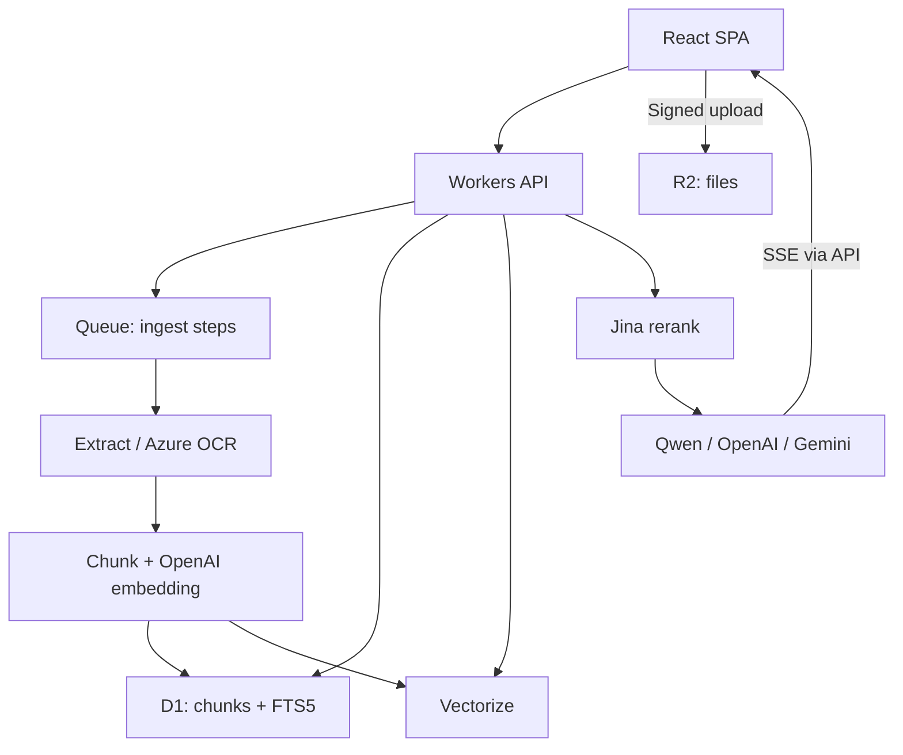

# Banking Document RAG — MVP

Trợ lý tra cứu tài liệu nghiệp vụ ngân hàng bằng tiếng Việt. Ưu tiên đơn giản, trả lời có căn cứ và cho phép kiểm tra nguồn.

**Trạng thái:** tài liệu thiết kế ban đầu (Cloudflare Workers, D1, Vectorize). Bản đã triển khai là FastAPI + SQLite tự host, mô tả ở [README gốc](../README.md); hai bản khác nhau về stack. Mục thiết kế dưới đây chỉ để tham khảo. Đọc [IMPLEMENTATION.md](IMPLEMENTATION.md) để thực hiện theo thứ tự.

## 1. Scope

### In-scope

- SPA desktop: chat, upload/danh sách tài liệu và cài đặt chat.
- Upload PDF, DOCX, TXT, PNG, JPG; OCR cho PDF scan/ảnh.
- Tự extract → chunk → embedding → cập nhật KB, không deploy lại khi thêm tài liệu.
- Hybrid retrieval (keyword + vector) → cross-encoder reranking → sinh câu trả lời.
- Chat streaming; citation mở đúng nguồn và đoạn trích.
- Thiếu dữ kiện làm thay đổi kết luận: hỏi lại. Không đủ nguồn: nêu chưa đủ căn cứ.
- Chọn Qwen/vLLM, OpenAI hoặc Gemini bằng cấu hình mặc định hoặc UI.
- Tùy chỉnh model được phép, giới hạn output, độ dài/phong cách; temperature khi model hỗ trợ.

### Out-of-scope

- Đăng nhập, phân quyền; dashboard quản trị toàn hệ thống.
- Chỉnh sửa thủ công vector DB.
- CRM, Zalo, Messenger.
- Agent, GraphRAG, fine-tuning, tự động chuyển model khi lỗi.
- Quy trình quản trị hiệu lực/sửa đổi văn bản pháp lý; không hứa chatbot tự xác định quy định đang có hiệu lực.

Không đăng nhập: mọi người truy cập được URL đều có thể chat, upload và xem nguồn. Đây không phải ranh giới truy cập nội bộ. R2 private và giữ secrets ở backend không thay thế kiểm soát truy cập người dùng.

## 2. Tech stack

| Thành phần | Lựa chọn |
|---|---|
| Frontend | React, TypeScript, Vite, Tailwind CSS; Cloudflare Pages |
| Backend | TypeScript, Hono, Zod; Cloudflare Workers |
| Files / OCR artifacts | Cloudflare R2 |
| Metadata / chunks / keyword | Cloudflare D1 + SQLite FTS5/BM25 |
| Dense retrieval | Cloudflare Vectorize, cosine, 1.536 dimensions |
| Embedding | OpenAI `text-embedding-3-small`, dimensions=1536 |
| Cross-encoder | Jina API, `jina-reranker-v2-base-multilingual` |
| OCR / PDF layout | Azure Document Intelligence `prebuilt-layout` |
| DOCX / TXT | Mammoth / UTF-8 decoding |
| Background ingestion | Cloudflare Queues + DLQ |
| Chat providers | OpenAI SDK cho OpenAI/vLLM; Google Gen AI SDK cho Gemini |
| Streaming / PDF | SSE qua POST fetch / PDF.js |
| Config | YAML + Zod validation; build-generated config |
| Tests | Vitest; Playwright cho luồng UI chính |

Không cần LangChain/LlamaIndex cho MVP. Model local không chạy trong Workers. Mac M2 dùng phát triển; nếu host Qwen trên Mac, máy cần luôn online, đủ RAM và backend inference hỗ trợ đúng checkpoint.

## 3. Luồng hệ thống



### Ingest

Create upload → upload R2 → confirm → enqueue → extract/OCR → chunk → embed/index → Ready.

- Status UI: `Processing`, `Ready`, `Failed`; bước nội bộ nằm trong `stage`.
- Chunk theo heading/điều/khoản, khoảng 500 token; tách nhỏ khi quá giới hạn reranker.
- Không gộp bảng với nội dung không liên quan; lặp heading bảng nếu phải chia.
- Lưu source spans để chunk đi qua nhiều trang vẫn trỏ đúng từng vùng.
- Chỉ tài liệu Ready được sử dụng. Ready sau khi D1 và Vectorize có thể đọc dữ liệu, không chỉ sau khi gửi yêu cầu ghi.
- ID ổn định giúp Queue retry không tạo bản sao. Không thêm content dedup phức tạp cho MVP.

### Chat

Câu hỏi + lịch sử ngắn → query độc lập nếu cần → FTS5 top 20 + vector top 20 → RRF → rerank tối đa 30 → 5–8 chunks → LLM → SSE.

Giữ nguyên số hiệu, điều/khoản và con số khi viết lại query. Query rewrite chỉ cần cho câu tiếp nối thiếu ngữ cảnh. FTS5 dùng keyword query đã escape, không đưa nguyên cú pháp người dùng vào MATCH.

Điểm retrieval/reranker không phải xác suất trả lời đúng. Không dùng một ngưỡng chung cho mọi model. Tinh chỉnh sau khi đánh giá tài liệu thật.

## 4. Citation

| Nguồn | Vị trí hiển thị |
|---|---|
| PDF | Tên file, trang PDF 1-indexed, đoạn trích; highlight theo OCR polygon |
| PNG/JPG | Tên ảnh, đoạn trích, vùng ảnh |
| DOCX | Heading hoặc số đoạn; không tạo số trang giả |
| TXT | Số dòng hoặc đoạn |

Model chỉ tham chiếu `[S1]`, `[S2]` từ danh sách server cung cấp. Server map citation sang chunk/source spans; không tin URL hoặc số trang do model tự viết. UI không hiển thị `% khớp`.

MVP stream trực tiếp nội dung; xác thực citation ID trước khi hiển thị thành liên kết. Điều này không bảo đảm mọi kết luận đều đúng; đánh giá nghiệp vụ vẫn cần thiết. Không thêm một LLM kiểm duyệt riêng ở bản đầu.

## 5. Cấu trúc thư mục dự kiến

```text
banking-rag/
├── README.md
├── IMPLEMENTATION.md
├── package.json                 # npm workspaces; commit lockfile
├── config.yaml                  # defaults; không có secret
├── .gitignore
├── scripts/
│   └── generate-config.ts       # YAML → validated server/public config
├── apps/
│   ├── web/
│   │   ├── package.json
│   │   ├── vite.config.ts
│   │   └── src/
│   │       ├── App.tsx
│   │       ├── components/      # Chat, Upload, Documents, Settings, CitationViewer
│   │       ├── lib/             # API client, SSE parser, local settings
│   │       └── generated/       # public defaults; generated
│   └── api/
│       ├── package.json
│       ├── wrangler.jsonc
│       ├── .dev.vars.example    # tên secret + placeholder
│       ├── migrations/001_init.sql
│       └── src/
│           ├── index.ts
│           ├── routes/          # uploads, documents, chat, config, health
│           ├── ingest/          # queue, extract, ocr, chunk, index
│           ├── rag/             # keyword, vector, fusion, rerank, prompt
│           ├── llm/             # interface, openai-compatible, gemini
│           ├── storage/         # D1/R2 access
│           └── generated/       # server config; generated
└── tests/
    ├── unit/
    ├── e2e/
    └── evaluation/               # câu hỏi + nguồn/đáp án do người đánh giá
```

Đây là cấu trúc cần tạo, không phải danh sách file đã có sẵn.

## 6. Config và secrets

```yaml
chat:
  active_provider: qwen
  providers:
    qwen:
      base_url: https://llm.example.com/v1
      model: YOUR_SERVED_MODEL
      allowed_models: [YOUR_SERVED_MODEL]
      api_key_env: QWEN_API_KEY
    openai:
      model: YOUR_OPENAI_MODEL
      allowed_models: [YOUR_OPENAI_MODEL]
      api_key_env: OPENAI_API_KEY
    gemini:
      model: YOUR_GEMINI_MODEL
      allowed_models: [YOUR_GEMINI_MODEL]
      api_key_env: GEMINI_API_KEY
  generation:
    max_output_tokens: 1500
    response_style: concise
    temperature: 0.2
retrieval:
  keyword_top_k: 20
  vector_top_k: 20
  rerank_top_k: 30
  context_top_k: 6
ingest:
  max_file_mb: 20
  target_chunk_tokens: 500
```

Model IDs là placeholder: điền model có thật và được tài khoản/endpoint hỗ trợ trước khi chạy. Không suy luận capabilities từ tên model; khai báo hỗ trợ temperature/reasoning trong cấu hình adapter và kiểm tra kết nối.

- YAML đọc lúc build/deploy; không đọc file trên Mac trong runtime Workers.
- UI override defaults bằng localStorage, chỉ áp dụng trình duyệt đó. Sửa YAML cần deploy lại; sửa UI không cần deploy.
- UI chỉ chọn provider/model allowlist; không nhập API key hay endpoint tùy ý trong MVP không auth.
- Backend kiểm tra allowlist và giới hạn token/tham số; không tin localStorage.
- Chuyển chat model không cần ingest lại. Chuyển embedding model/dimensions cần reindex.
- Đừng gửi server config hoặc secret về frontend. Public config chỉ chứa tên provider/model và lựa chọn UI.

Secrets: `OPENAI_API_KEY`, `QWEN_API_KEY`, `GEMINI_API_KEY`, `JINA_API_KEY`, `AZURE_DOCUMENT_INTELLIGENCE_KEY`; endpoint Azure là backend config. Signed R2 upload cần credentials có quyền đúng bucket; chỉ lưu backend. Qwen HTTPS endpoint phải truy cập được từ Workers và có API key. Không public cổng inference không bảo vệ.

## 7. Cách chạy dự kiến

Các scripts sau cần được implement trong bước bootstrap:

```bash
npm install
npm run config:generate
npm run db:migrate:local
npm run dev:api
# terminal khác
npm run dev:web
```

Production: tạo Cloudflare resources, migrate D1 remote, set secrets, deploy API rồi build/deploy Pages; xem hướng dẫn đi kèm. Không coi các lệnh này là đã chạy hoặc đã kiểm chứng trong repo.

## 8. Definition of done

- Mỗi định dạng có ít nhất một fixture ingest thành công; scan tiếng Việt được kiểm tra thủ công.
- Upload mới sử dụng được mà không redeploy; job retry không tạo chunks/vector trùng.
- Chat stream với cả ba provider khi có credentials tương ứng.
- Click citation đúng nguồn; ID không hợp lệ không trở thành liên kết.
- Tình huống thiếu dữ kiện/thiếu căn cứ xử lý đúng trên bộ đánh giá.
- Đo latency và chi phí thực tế, không hứa SLA trước khi benchmark phần cứng/API.
- Không để secrets trong Git, JS bundle, public config hoặc logs.

## 9. Tham khảo triển khai

- Workers: https://developers.cloudflare.com/workers/
- D1 / FTS5: https://developers.cloudflare.com/d1/sql-api/sql-statements/
- Vectorize: https://developers.cloudflare.com/vectorize/
- Queues: https://developers.cloudflare.com/queues/
- R2 presigned URLs: https://developers.cloudflare.com/r2/api/s3/presigned-urls/
- Azure Layout: https://learn.microsoft.com/azure/ai-services/document-intelligence/prebuilt/layout
- vLLM: https://docs.vllm.ai/
- Gemini API: https://ai.google.dev/gemini-api/docs
- Jina reranking: https://jina.ai/reranker/

Chốt phiên bản SDK, API và model trong lúc implement; không tự động cập nhật dependency production.
